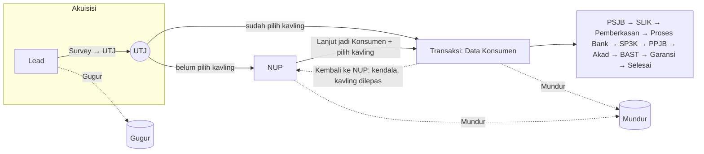
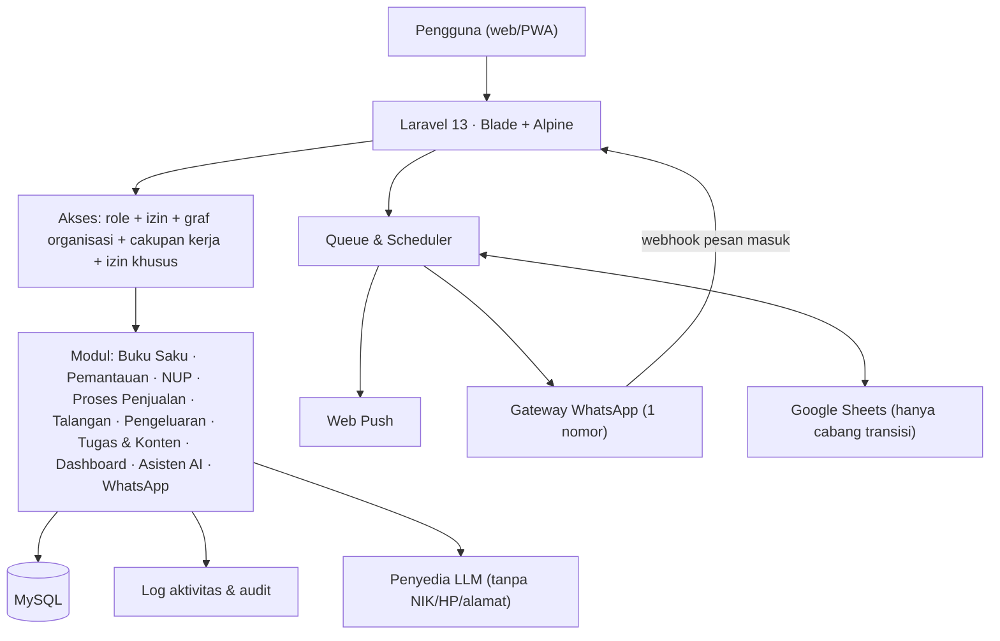

# PRD — OASIS CRM v3 (Gabungan & Perapian Struktural)

| | |
|---|---|
| **Produk** | OASIS CRM (Online & Offline Sales Integration System) |
| **Versi dokumen** | 3.3 — memuat keputusan hasil review WP-0 (D30–D33) |
| **Tanggal** | 20 November 2026 |
| **Basis kode yang diaudit** | `marketingbranding/oasiscrm` commit `f42aa91` (16 Nov 2026) |
| **Menggantikan** | `prd.md` (ringkasan OASIS) dan `properti-subsidi-ai-PRD.md` (PRD visi). Untuk detail form per tahap Proses Penjualan, dokumen ini tetap merujuk `docs/product/PRD_OASIS_CRM_Consumer_Database_Platform_V2.md` dengan revisi pada §6.4. Untuk migrasi data, rujukannya `MARISON_V2_TO_OASIS_MIGRATION_CONTRACT_v1.md`. |

### Cara membaca dokumen ini

Setiap fitur diberi label status:

- **[Berjalan]** — sudah ada di OASIS dan dipertahankan apa adanya.
- **[Perbaikan]** — sudah ada, tetapi perilaku atau strukturnya harus diubah sesuai dokumen ini.
- **[Baru]** — belum ada di OASIS.
- **[Transisi]** — dipertahankan sementara, lalu dipensiunkan sesuai rencana migrasi.

Semua angka dan aturan bisnis dikumpulkan di **§6 Aturan Bisnis**. Jika bab lain berbeda dengan §6, yang berlaku adalah §6. Semua keputusan produk tercatat di **§13**.

---

## 1. Ringkasan

### 1.1 Masalah

OASIS sudah berjalan dan menyatukan banyak pekerjaan: lead sales, agenda, proses konsumen, dana talangan, pengeluaran, konten, dan kolaborasi. Karena dikembangkan dengan terburu-buru, ada beberapa lubang struktural:

1. **Istilah dan tahapan tidak seragam.** Tahap lead di kode (sampai Akad) bertabrakan dengan prinsip "lead terpisah dari proses penjualan". Kata "agenda" juga dipakai untuk tiga hal berbeda.
2. **Data konsumen punya tiga jalur sekaligus**: modul Database (cache sheet cabang), Konsumen Progress (snapshot sheet), dan tabel `consumer_*`. Tidak ada satu sumber kebenaran.
3. **Hak pantau belum mengikuti struktur organisasi.** Graf organisasi sudah dibangun, tetapi mode kanonisnya belum diaktifkan. Pemantauan masih per cabang, bukan berjenjang.
4. **Aturan kerja di kode tidak sesuai lapangan.** Target harian di kode 420 menit mulai 09.00, sedangkan di lapangan 480 menit dengan jam Jumat yang berbeda. Angka-angka ini juga di-hardcode.
5. **Beberapa kebutuhan lapangan belum ada**: alih lead, riwayat cicilan dana talangan, WhatsApp terpusat, asisten AI sesuai peran, dan kalender gabungan.
6. **Dokumentasi produk terpecah.** Ringkasan PRD tidak menyebut fitur yang sudah berjalan (Sales Fee, Promo, AI Chat, PWA, target lead, bukti foto agenda), sedangkan PRD visi ditulis seolah membangun dari nol dengan teknologi yang berbeda.

### 1.2 Tujuan

1. OASIS menjadi **satu sumber data** untuk lead, proses penjualan, dana talangan, pengeluaran, dan kegiatan tim. Google Sheets turun peran menjadi arsip atau ekspor, bertahap per cabang.
2. **Istilah, tahapan, dan aturan bisnis seragam**, terdokumentasi di satu tempat, dan bisa diubah lewat pengaturan tanpa deploy ulang.
3. **Hak akses mengikuti struktur organisasi berjenjang**, dengan isolasi data antar tim.
4. **Bisa diakses dari mana saja** (web dan PWA), terutama oleh sales di lapangan dan pimpinan yang sedang di luar kota.
5. **Semua perubahan penting tercatat** (siapa, kapan, dari apa, menjadi apa).

### 1.3 Cakupan

- **Satu perusahaan (internal)** dengan banyak cabang, banyak proyek, dan banyak tim. OASIS **bukan** aplikasi SaaS multi-perusahaan.
- Pengguna: Sales, Koordinator Sales, Supervisor, Manager dan Ass. Manager (pusat dan cabang), Branch Manager, Staff Admin (jenis Admin Cabang, Sales/SAS, Marketing/SAM, dan Umum), Tim Pusat, dan Superadmin.

### 1.4 Di luar cakupan versi ini

- Multi-perusahaan/tenant.
- Aplikasi mobile native (cukup PWA).
- Integrasi langsung ke sistem bank atau SLIK OJK.
- Portal untuk konsumen akhir.
- Alur persetujuan pengeluaran (lihat BR-40).

---

## 2. Prinsip Produk

Prinsip ini menggabungkan PRD V2 dan PRD visi, dan dipakai untuk memutuskan kasus yang tidak diatur secara eksplisit.

1. **OASIS lebih dulu.** Kegiatan operasional baru dicatat di OASIS. Spreadsheet hanya dipakai selama masa transisi cabang tersebut.
2. **Lead terpisah dari proses penjualan.** Lead mengurus akuisisi sampai UTJ. Setelah itu perjalanan konsumen dikelola sebagai **Transaksi**.
3. **Satu orang, banyak transaksi.** `Customer` (orang) berbeda dari `Transaksi` (satu perjalanan pembelian).
4. **Admin hanya menginput fakta baru.** Data yang sudah diketahui OASIS tidak diminta diketik ulang.
5. **Event bukan tahap.** Pindah Kavling, Ganti Nama, Ganti Bank, Kembali ke NUP, Mundur, dan Koreksi Data adalah kejadian yang tercatat di riwayat, bukan langkah di jalur utama.
6. **Fleksibel, tapi teraudit.** Koreksi tidak butuh persetujuan berlapis, tetapi selalu menyimpan data sebelum, sesudah, pelaku, waktu, dan sumber.
7. **Kunci keras hanya untuk integritas.** Contohnya kavling aktif ganda, ID transaksi yang tidak boleh berubah, konflik penyimpanan bersamaan, akses di luar wewenang, dan penghapusan permanen.
8. **Aturan disimpan di pengaturan, bukan di kode.** Jam kerja, target menit, batas wewenang sales, daftar alasan, dan sejenisnya bisa diubah Superadmin.
9. **Menu bukan otorisasi.** Menyembunyikan menu tidak menggantikan pemeriksaan hak akses di server.
10. **Data pribadi seminimal mungkin.** NIK, nomor HP, dan alamat hanya ditampilkan kepada yang berwenang, dan tidak dikirim ke layanan AI (BR-70).

---

## 3. Glosarium

Istilah di tabel ini wajib dipakai di UI, kode baru, laporan, dan dokumen.

| Istilah | Definisi | Catatan perubahan |
|---|---|---|
| **Lead** | Calon pembeli yang sedang diprospek oleh satu Sales pemilik. Berakhir di **UTJ** atau **Gugur**. | Tahap Berkas Awal dan Akad dihapus dari lead (BR-11). |
| **Tahap Lead** | Lead Baru → Dihubungi → Tatap Muka → Survey → UTJ. | Gabungan kode dan PRD visi (BR-10). |
| **Follow-up** | Aktivitas atau pengingat untuk menghubungi lead lagi. **Bukan tahap.** | |
| **Gugur (lead)** | Lead berhenti sebelum UTJ, dengan alasan. | |
| **UTJ** | Uang Tanda Jadi. Batas akhir wewenang Sales atas lead. | |
| **NUP** | Konsumen yang **sudah UTJ tetapi belum memegang kavling**: belum memilih kavling, atau kavlingnya dilepas karena transaksinya tertahan masalah. | Revisi atas PRD V2 (BR-20). |
| **Customer** | Data orang: identitas dan kontak. | |
| **Transaksi** | Satu perjalanan pembelian unit: Data Konsumen → … → Selesai. Punya `id_transaksi` yang tidak boleh berubah. | Di kode: `consumer_applications`. |
| **Proses** | Tahap transaksi: Data Konsumen, PSJB, BI Checking/SLIK, Pemberkasan, Proses Bank, SP3K, PPJB Developer, Akad, BAST, Garansi, Selesai. | |
| **Status Transaksi** | **Lanjut**, **Mundur**, atau **Ditutup**. Ditutup hanya terjadi lewat event Ganti Nama atau Kembali ke NUP, dan tidak dihitung aktif maupun gugur. Selesai diturunkan dari proses terakhir (D23). | Revisi PRD V2: "Diganti Konsumen" menjadi event Ganti Nama yang menutup transaksi lama (D31). |
| **Event Transaksi** | Pindah Kavling, Ganti Nama, Ganti Bank, Kembali ke NUP, Koreksi Data. | |
| **Kendala** | Masalah yang menghambat transaksi, misalnya kolektibilitas 5 atau berkas kurang. | |
| **Rencana Harian Sales** | Daftar kegiatan satu Sales untuk satu hari kerja dengan target 480 menit. | Dulu "Agenda Sales" / Daily Plan. |
| **Kegiatan** | Satu baris di Rencana Harian Sales (visit, follow-up, administrasi, dll.). | |
| **Tugas & Konten** | Pekerjaan tim marketing/konten di Work Planner. | Dulu "agenda/konten" di Work Planner. |
| **Kalender** | Tampilan gabungan yang membaca Rencana Harian Sales dan Tugas & Konten. Tidak menyimpan data sendiri. | Baru. |
| **Bawahan langsung / turunan** | Hubungan atasan–bawahan pada graf organisasi (`organization_assignments`). | |
| **Cakupan kerja** | Cabang/proyek tempat user boleh bekerja (`branch_user`, `project_user`). | |
| **Dana Talangan** | Dana yang ditalangi perusahaan untuk konsumen, dengan komitmen pengembalian. | |
| **Cicilan Talangan** | Satu pembayaran pengembalian dana talangan. | Baru. |

---

## 4. Peran dan Struktur Organisasi

### 4.1 Daftar role

Role mengikuti role yang sudah ada di kode, ditambah **Ass. Manager**. Tipe sales (Inhouse/OJT/Freelance) menjadi **atribut user**, bukan role.

| Role (slug) | Nama di UI | Lingkup | Cakupan data | Peran pantau | Status |
|---|---|---|---|---|---|
| `superadmin` | Super Admin | umum | Semua | Kelola penuh | [Berjalan] |
| `pusat` | Tim Pusat | pusat | Lihat BR-52 | Sesuai izin modul | [Perbaikan] |
| `manager` | Manager | pusat / cabang* | Pusat: semua cabang. Cabang: turunannya. | Pantau berjenjang, hanya baca | [Perbaikan] |
| `ass_manager` | Ass. Manager | pusat / cabang* | Sama dengan Manager | Pantau berjenjang, hanya baca | [Baru] |
| `branch_manager` | Branch Manager | cabang | Turunannya di cabangnya | Pantau berjenjang, hanya baca | [Perbaikan] |
| `supervisor` | Supervisor (SPV) | pusat / cabang* | Turunannya | Pantau berjenjang, hanya baca | [Perbaikan] |
| `sales_coordinator` | Koordinator Sales | cabang | Timnya | Pantau **dan kelola** tim, termasuk alih lead | [Perbaikan] |
| `sales` | Sales | cabang | Data miliknya | — | [Berjalan] |
| `staff` | **Staff Admin**, dengan 4 jenis: **Admin Cabang** (eks `admin`), **Sales (SAS)**, **Marketing (SAM)**, **Umum** (eks `staff`) | cabang | Cabangnya, sesuai izin jenisnya | Sesuai jenis (lihat §4.4) | [Perbaikan]: `admin`, `sas`, `sam` digabung ke sini sebagai jenis |
| `admin`, `sas`, `sam` | (lama) | — | — | — | [Transisi]: pengguna dipindah ke Staff Admin dengan jenis yang sesuai. Hak akses tiap orang **wajib sama persis** dengan sebelum penggabungan (dibuktikan terhadap snapshot permission), kecuali tambahan hak input SAS (D32). Role lama ditandai usang, tidak dihapus. |

\* Lingkup pusat atau cabang ditentukan oleh **penempatan user** (atribut `scope_level` pada user: `pusat` atau `cabang`), bukan dengan menggandakan role. Kebijakan ini dipilih supaya daftar role tidak membengkak. Ini sudah diputuskan (D25).

**Atribut user baru:**
- `sales_type`: `inhouse`, `ojt`, `freelance` (wajib untuk role Sales).
- `staff_type`: `admin_cabang`, `sales` (SAS), `marketing` (SAM), `umum` (wajib untuk role Staff Admin). Izin modul diberikan **per jenis**, sehingga keempat jenis tetap punya akses yang berbeda walaupun satu role.
- `scope_level`: `pusat` atau `cabang`.

Di bagian lain dokumen ini, "Admin Cabang", "SAS", dan "SAM" berarti Staff Admin jenis Admin Cabang, Sales, dan Marketing.

### 4.2 Struktur organisasi [Perbaikan]

- **Sumber kebenaran hubungan atasan–bawahan** adalah `organization_assignments` (graf "orang melapor ke orang"). Graf ini menyimpan riwayat, tanggal berlaku, pencegahan siklus, dan aturan role. Model `org_units` dari PRD visi **tidak dipakai**, karena graf yang sudah ada lebih lengkap.
- **Mode kanonis wajib diaktifkan** (Fase 1). Syaratnya: `organization:backfill --dry-run` dan laporan paritas tidak menyisakan konflik yang belum dijelaskan. Setelah itu `users.supervisor_user_id` dan `sales_coordinator_sales` hanya menjadi proyeksi baca, lalu dipensiunkan.
- **Tampilan Susun Organisasi:** kartu orang bisa digeser untuk mengganti atasan. Menggeser kartu hanya mengubah atasan, tidak mengubah role. Mengubah role juga tidak otomatis mengubah atasan.
- **Tim Sales** = Koordinator beserta Sales yang melapor kepadanya pada proyek tertentu.

### 4.3 Hak pantau berjenjang [Perbaikan]

1. Pemantau melihat **seluruh turunan** dirinya pada graf organisasi, bukan seluruh cabang.
2. Turunan yang terlihat tetap dibatasi **cakupan kerja** (cabang/proyek). Pengecualian: role pimpinan pusat (BR-52).
3. **Tingkat detail menurun sesuai jarak:**
   - Bawahan langsung: detail penuh.
   - Turunan yang lebih jauh: ringkas, yaitu nama lead, sales pemilik, proyek, tahap, dan tanggal terakhir aktif.
   - Filter di layar pemantauan per orang di jenjang bawahan langsung, misalnya Manager memfilter per SPV atau Koordinator, bukan per sales.
4. **Hanya Koordinator yang bisa mengubah** data timnya: alih lead, koreksi rencana harian. Supervisor, Branch Manager, Manager, dan Ass. Manager **hanya membaca**.
5. **Isolasi tim:** data tim Koordinator A tidak terlihat oleh Koordinator B. Pengecualian hanya lewat **Izin Akses Khusus** [Baru]: pemberian akses eksplisit per user dan per modul (lead/rencana harian/keuangan, lihat atau ubah), punya tanggal berakhir, dan tercatat di audit.

> **Perubahan dari perilaku sekarang:** Supervisor dan Branch Manager saat ini memantau seluruh cabang. Setelah perubahan ini, mereka hanya melihat turunannya. Karena Branch Manager biasanya berada di puncak cabang, dalam praktik cakupannya tetap seluruh cabang. Yang berubah adalah dasar perhitungannya.

### 4.4 Matriks akses modul (ringkas)

Keterangan: **K** = kelola, **I** = input/ubah milik sendiri atau cakupannya, **L** = lihat, **—** = tidak ada akses.

| Modul | Superadmin | Mgr/Ass. Mgr pusat | Mgr/Ass. Mgr/BM cabang | SPV | Koordinator | Sales | Admin Cabang | SAS | SAM | Staff Umum | Tim Pusat |
|---|---|---|---|---|---|---|---|---|---|---|---|
| Lead | K | L | L | L | L + alih | I (miliknya) | L | L | L | — | L |
| Rencana Harian Sales | K | L | L | L | L + koreksi | I | — | L | L | — | L |
| NUP & Proses Penjualan | K | L | L | L | L | L (miliknya) | I | I (baru, D32) | — | I (ditugaskan) | L/I* |
| Dana Talangan | K | L | L | L | L | — | I | — | — | I (ditugaskan) | L/I* |
| Pengeluaran | K | L | L | L | — | — | — | — | — | I (ditugaskan) | I |
| Tugas & Konten | K | L | L | L | L | L | I | — | — | I (miliknya) | I |
| Proyek & Kavling | K | L | L | L | L | L | L | L | L | L | L |
| Promo | K | L | L | L | L | L | I | — | — | — | I |
| Pengguna & Organisasi | K | L | L (cabangnya) | — | — | — | I (cabangnya) | — | — | — | — |
| Asisten AI | Umum | Pimpinan | Pimpinan | Pimpinan | Koordinator | Sales | Umum | Umum | Umum | Umum | Umum |
| WhatsApp | K | — | — | — | L | I | — | — | — | — | — |

\* Sesuai izin modul yang dipetakan kepada Tim Pusat.

Kolom Admin Cabang, SAS, SAM, dan Staff Umum adalah ringkasan hak akses **saat ini** menurut snapshot permission sebelum v3 (`tests/Fixtures/permission_snapshot_pre_v3.json`). Snapshot itulah acuan detailnya. Satu-satunya perubahan yang disengaja adalah hak input NUP & Proses Penjualan untuk SAS (D32), yang dikerjakan di paket kerja terpisah setelah penggabungan role terbukti tidak mengubah hak siapa pun.

Detail izin per tombol tetap mengikuti tabel `permissions` yang sudah ada. Matriks ini adalah **target perilaku**, dan setiap izin baru wajib terdaftar di sana.

---

## 5. Peta Domain

- Satu **Customer** dapat memiliki banyak **Transaksi**.
- Setiap Transaksi menyimpan asal-usulnya: `source_lead_id` dan/atau `source_nup_id`.
- **Kavling** hanya boleh dipegang **satu transaksi aktif** pada satu waktu. NUP tidak memegang kavling.

---

## 6. Aturan Bisnis (sumber kebenaran tunggal)

Setiap aturan bertanda ⚙ disimpan di **Pengaturan** (lihat §7.2.4), tidak di-hardcode.

### 6.1 Jam kerja dan Rencana Harian Sales

| ID | Aturan | Status |
|---|---|---|
| BR-01 ⚙ | **Senin–Kamis:** masuk 08.00, pulang 17.00, istirahat 12.00–13.00 → **480 menit**. | [Perbaikan] (kode: 09.00, 420 menit) |
| BR-02 ⚙ | **Jumat:** masuk 07.30, pulang 17.00, istirahat 11.30–13.00 → **480 menit**. | [Baru] |
| BR-03 ⚙ | Jam mulai kegiatan pertama otomatis mengikuti jam masuk hari itu. Kegiatan berikutnya berurutan. Kegiatan boleh melewati jam istirahat tanpa dipecah, dan jam istirahat tidak dihitung. | [Perbaikan] |
| BR-04 ⚙ | Rencana Harian Sales hanya bisa **dikirim jika totalnya tepat 480 menit**. Draf boleh kurang, tidak boleh lebih. | [Perbaikan] (kode: 420) |
| BR-05 | Setelah dikirim, Sales tidak bisa mengubah rencana. Sales tetap bisa mengisi hasil kegiatan dan menyelesaikannya. Koordinator boleh mengoreksi rencana yang sudah dikirim, dengan syarat total tetap 480 menit. Setiap koreksi tercatat dan Sales diberi notifikasi. | [Berjalan] |
| BR-06 ⚙ | Pengingat kegiatan: 15 menit sebelum mulai, saat mulai, 15 menit sebelum selesai, dan 15 menit setelah selesai jika belum ditandai selesai. | [Berjalan] |
| BR-07 | Bukti foto kegiatan bersifat opsional, maksimal 2 foto. Arsip mingguan, dan pembersihan lokal setelah ≥ 60 hari oleh Superadmin (aturan teknis lengkap tetap mengikuti README). | [Berjalan] |
| BR-08 ⚙ | **Sabtu, Minggu, dan hari libur bebas.** Tidak ada target 480 menit dan tidak ada kewajiban mengirim Rencana Harian. Sales tetap boleh mencatat kegiatan (mis. open house akhir pekan), dan pengingat tetap berjalan untuk kegiatan yang dicatat. Hari-hari ini tidak dihitung dalam capaian menit dan tidak memicu penanda "rencana belum dikirim". | [Baru] |
| BR-09 ⚙ | Daftar hari libur (nasional dan cuti bersama, bisa ditambah libur khusus per cabang) dikelola Superadmin di Pengaturan. | [Baru] |

### 6.2 Lead

| ID | Aturan | Status |
|---|---|---|
| BR-10 ⚙ | Tahap lead: **Lead Baru → Dihubungi → Tatap Muka → Survey → UTJ**. Tahap boleh dilompati ke depan. Mundur tahap hanya lewat Koreksi Data yang teraudit. | [Perbaikan] |
| BR-11 | Tahap **Berkas Awal Lengkap** dan **Akad** dihapus dari lead. Informasi itu dibaca dari Transaksi yang terhubung, dan tampil sebagai keterangan di halaman lead, bukan tahap. | [Perbaikan] |
| BR-12 | **Follow-up bukan tahap.** Follow-up dicatat sebagai kegiatan di Rencana Harian Sales dan/atau pengingat pada lead. | [Perbaikan] |
| BR-13 ⚙ | Lead dapat ditutup sebagai **Gugur** dengan alasan dari daftar (mis. tidak berminat, tidak bisa dihubungi, tidak lolos syarat subsidi, pindah ke developer lain, lainnya). | [Perbaikan] |
| BR-14 ⚙ | **Sales hanya boleh mengubah lead sampai UTJ.** Setelah UTJ, lead terkunci untuk Sales dan perjalanan berlanjut di NUP/Transaksi. | [Perbaikan] |
| BR-15 | Nomor HP wajib di formulir lead interaktif dan dinormalisasi. OASIS memeriksa duplikat nomor saat lead dibuat (fitur cek duplikat sudah ada). | [Berjalan] |
| BR-16 | Target lead bulanan disimpan per Sales per bulan. Tanpa target, tampil "Belum ditetapkan" dan pencapaian "N/A". | [Berjalan] |

### 6.3 UTJ, NUP, dan konversi

| ID | Aturan | Status |
|---|---|---|
| BR-20 | **NUP = sudah UTJ, belum memegang kavling.** Ada dua jalan masuk: (a) dari lead yang sudah UTJ tetapi belum memilih kavling; (b) **Kembali ke NUP** dari transaksi yang tertahan kendala, misalnya kolektibilitas 5 atau masalah berkas, sementara konsumen masih ingin membeli. | [Perbaikan] (PRD V2: NUP = waiting list tanpa UTJ) |
| BR-21 | Pada **Kembali ke NUP**, kavling transaksi **dilepas** dan menjadi tersedia lagi. Transaksi lama berstatus **Ditutup** dengan catatan event, dan riwayatnya disimpan. Kendala yang menjadi alasan wajib dicatat dan terhubung ke NUP. | [Baru] |
| BR-22 | **Lanjut jadi Konsumen** dari NUP: pilih kavling, lalu OASIS membuat atau menyambungkan Customer dan membuat Transaksi baru. Data yang sudah ada tidak diketik ulang. | [Berjalan] (konversi NUP sudah ada) |
| BR-23 | **Jadikan Konsumen** dari lead **biasanya setelah UTJ**. Pengecualian: Admin Cabang, SAS, atau Koordinator boleh mengonversi sebelum UTJ dengan **alasan wajib**, dan tindakan ini tercatat sebagai pengecualian di audit dan laporan. | [Perbaikan] |
| BR-24 | Konversi bersifat **idempoten**: lead yang sudah dikonversi tidak boleh membuat transaksi ganda tanpa tindakan eksplisit. | [Berjalan] |
| BR-25 | Satu kavling hanya boleh dipegang satu transaksi berstatus Lanjut. | [Berjalan] |

### 6.4 Transaksi (revisi PRD V2 §14)

| ID | Aturan | Status |
|---|---|---|
| BR-30 | Status transaksi: **Lanjut**, **Mundur**, dan **Ditutup**. **Ditutup** tidak bisa dipilih manual; status ini hanya diberikan oleh event Ganti Nama atau Kembali ke NUP. Transaksi Ditutup tidak dihitung sebagai transaksi aktif maupun gugur. "Diganti Konsumen" **bukan status**, melainkan event Ganti Nama. | [Perbaikan] |
| BR-31 ⚙ | **Mundur** wajib beralasan, minimal: Mundur atas permintaan konsumen, Reject SLIK, Reject Bank, Lainnya. Alasan ini juga menjadi dasar perhitungan "gugur" di laporan. | [Perbaikan] |
| BR-32 | Event yang tercatat di riwayat: **Pindah Kavling**, **Ganti Nama**, **Ganti Bank**, **Kembali ke NUP**, **Koreksi Data**. | [Perbaikan] (Kembali ke NUP baru) |
| BR-33 | **Ganti Nama:** transaksi lama berstatus **Ditutup** dan transaksi pengganti dibuat dengan rujukan ke transaksi lama. Kavling, Sales, dan riwayat proses yang relevan dipindahkan. | [Berjalan] (route `ganti-konsumen`; status lama `DIGANTI_KONSUMEN` dipetakan ke Ditutup) |
| BR-34 | **Pindah Kavling:** kavling lama dilepas dan kavling baru dipegang dalam satu transaksi atomik. Riwayat penempatan disimpan. | [Berjalan] |
| BR-35 | Urutan PSJB dan BI Checking/SLIK boleh berbeda per cabang atau bank (PSJB dulu, SLIK dulu, atau paralel), sesuai PRD V2 §4.1. Tampilan default: PSJB lalu SLIK. | [Berjalan] |
| BR-36 | Data lama boleh masuk langsung di posisi proses saat ini tanpa mengarang riwayat (PRD V2 §2.6). | [Berjalan] |

### 6.5 Keuangan

| ID | Aturan | Status |
|---|---|---|
| BR-40 | **Pengeluaran cukup dicatat.** Tidak ada alur persetujuan. Status: Aktif, Dibatalkan. Data yang sudah diproses dikunci (penguncian optimistis/`lock_version`). | [Berjalan] (PRD visi diajukan → disetujui → dibayar **tidak dipakai**) |
| BR-41 | Pembatalan pengeluaran wajib beralasan dan tercatat. Data tidak dihapus permanen. | [Berjalan] |
| BR-42 | **Database OASIS menjadi sumber utama Dana Talangan.** Tab Google "Talangan" dibekukan menjadi arsip/ekspor setelah migrasi per cabang lolos rekonsiliasi. | [Perbaikan] |
| BR-43 | **Cicilan Talangan:** setiap pembayaran dicatat dengan tanggal, nominal, metode, bukti (opsional), catatan, dan pemverifikasi. | [Baru] |
| BR-44 ⚙ | Status cicilan: **Belum**, **Sanggup**, **Bermasalah**, **Lunas**. **Lunas otomatis** jika total pembayaran terverifikasi ≥ nominal talangan. Status lain diatur manual. | [Baru] |

### 6.6 Organisasi dan akses

| ID | Aturan | Status |
|---|---|---|
| BR-50 | Atasan–bawahan hanya ditentukan oleh `organization_assignments`. Urutan tampilan tidak memengaruhi akses. | [Perbaikan] |
| BR-51 | Pemantau melihat seluruh turunannya, dengan detail penuh untuk bawahan langsung dan ringkas untuk yang lebih jauh. Hanya Koordinator yang bisa mengubah data tim. | [Perbaikan] |
| BR-52 | **Manager, Ass. Manager, dan SPV ber-`scope_level` pusat otomatis mencakup semua cabang.** Tim Pusat (staf) tetap mengikuti izin modul yang dipetakan. | [Perbaikan] (kode: pusat hanya sesuai penugasan) |
| BR-53 | Isolasi tim adalah bawaan. Akses lintas tim hanya lewat Izin Akses Khusus yang punya masa berlaku dan teraudit. | [Baru] |
| BR-54 | **Alih Lead** hanya oleh Koordinator, untuk lead milik Sales di timnya, ke Sales lain di timnya. Alasan wajib dipilih: Sales keluar, pindah cabang, pindah proyek, beban tidak seimbang, lainnya. Sales tujuan diberi notifikasi. Riwayat alih lead tidak bisa dihapus. | [Baru] |
| BR-55 | Lead dari Sales yang dinonaktifkan **tidak boleh yatim**. Saat menonaktifkan Sales, sistem meminta lead aktifnya dialihkan terlebih dahulu (atau menampilkannya di antrean alih lead Koordinator). | [Baru] |

### 6.7 WhatsApp

| ID | Aturan | Status |
|---|---|---|
| BR-60 | Satu nomor WhatsApp terpusat untuk Sales, lewat **gateway tidak resmi**. Risikonya (nomor bisa diblokir, gateway tidak stabil) **sudah diterima pemilik produk**. | [Baru] |
| BR-61 | Pesan keluar dikirim dari halaman lead, tercatat per pengirim, lead, waktu, isi, dan status kirim. | [Baru] |
| BR-62 | Pesan masuk dicocokkan ke lead berdasarkan nomor HP yang dinormalisasi. Pesan yang tidak cocok masuk kotak **Belum Tertaut** untuk ditautkan manual. | [Baru] |
| BR-63 ⚙ | Untuk mengurangi risiko blokir: ada batas kirim per menit dan per hari, jeda acak antar pesan, dan **larangan kirim massal/broadcast** dari fitur ini. | [Baru] |
| BR-64 | Sales hanya melihat percakapan lead miliknya. Koordinator melihat percakapan timnya. | [Baru] |

### 6.8 Data pribadi dan AI

| ID | Aturan | Status |
|---|---|---|
| BR-70 | NIK, nomor HP, dan alamat **tidak pernah dikirim** ke penyedia AI. Nama konsumen boleh dikirim (dapat dimatikan di pengaturan). | [Perbaikan] |
| BR-71 | NIK disamarkan di tampilan. Membuka NIK lengkap butuh izin khusus dan tercatat (fitur `nik-reveal` sudah ada). | [Berjalan] |
| BR-72 | Asisten AI hanya membaca data dalam cakupan pengguna yang bertanya, dengan aturan akses yang sama seperti layar biasa. | [Perbaikan] |
| BR-73 | Kunci API penyedia AI dan gateway WhatsApp disimpan terenkripsi di server dan tidak pernah dikirim ke browser. | [Baru] |

### 6.9 Audit

| ID | Aturan | Status |
|---|---|---|
| BR-80 | Setiap perubahan status, tahap, kepemilikan lead, data transaksi, dana talangan, cicilan, dan pengeluaran mencatat siapa, kapan, data sebelum, data sesudah, sumber (web/impor/sinkron/AI), dan alasan bila ada. | [Berjalan] → diperluas ke data baru |
| BR-81 ⚙ | Log aktivitas disimpan minimal **12 bulan**. | [Baru] (kebijakan retensi) |

---

## 7. Modul dan Fitur

### 7.1 Akun dan Akses — [Berjalan]

Login sesi, aktivasi undangan, lupa kata sandi, wajib ganti kata sandi, impersonasi oleh Superadmin, dan impor pengguna massal (XLSX dengan pratinjau dan konfirmasi). Perubahan yang dibutuhkan:

- **[Perbaikan]** Formulir pengguna menambah `sales_type` dan `scope_level`, serta role **Ass. Manager**.
- **[Perbaikan]** Penonaktifan Sales menjalankan BR-55.

### 7.2 Organisasi dan Pengaturan

#### 7.2.1 Cabang, Proyek, Kavling — [Berjalan]
Cabang terhubung ke banyak proyek. Kavling dikelola per proyek, termasuk impor massal.

#### 7.2.2 Susun Organisasi — [Perbaikan]
Papan berjenjang berisi kartu orang. Ganti atasan dengan menggeser kartu. Ada riwayat perubahan atasan, tanggal berlaku, dan pencegahan siklus. Mode kanonis diaktifkan (§4.2).

#### 7.2.3 Izin Akses Khusus — [Baru]
Daftar pemberian akses lintas tim: penerima, tim/unit yang dibuka, modul, lihat/ubah, berlaku sampai, alasan, dan pemberi.

#### 7.2.4 Pengaturan Aturan — [Baru]
Satu halaman Superadmin untuk semua aturan bertanda ⚙ di §6: jam kerja per hari, target menit, daftar alasan (gugur, mundur, alih lead), batas wewenang Sales, batas kirim WhatsApp, retensi log, dan izin kirim nama ke AI. Setiap perubahan pengaturan diaudit dan berlaku tanpa deploy.

### 7.3 Buku Saku Sales

| Fitur | Status | Inti perubahan |
|---|---|---|
| Lead: catat, cek duplikat, detail, kunjungan lokasi, upaya SLIK, UTJ | [Perbaikan] | Tahap lead mengikuti BR-10 sampai BR-14. |
| Follow-up | [Perbaikan] | Menjadi daftar "Perlu dihubungi" dari pengingat dan kegiatan, bukan tahap. |
| Rencana Harian Sales | [Perbaikan] | Mengikuti BR-01 sampai BR-05 (480 menit, Jumat beda). |
| Bukti foto kegiatan | [Berjalan] | — |
| Target lead bulanan | [Berjalan] | — |
| Pengingat kegiatan | [Berjalan] | Ditambah push notification PWA (§7.11). |
| Laporan Sales Fee | [Berjalan] | Didokumentasikan: laporan fee per sales per proyek, ekspor dan cetak. |
| Onboarding Buku Saku | [Berjalan] | — |
| Sinkron lead ke workbook cabang | [Transisi] | Dipensiunkan per cabang setelah cabang lulus migrasi. |

### 7.4 Pemantauan Tim — [Perbaikan]

- **Rencana Harian Tim:** dikelompokkan per bawahan langsung, lalu turunannya. Menampilkan capaian menit/480, status kirim, dan kegiatan terlambat.
- **Lead Tim:** detail penuh untuk bawahan langsung, ringkas untuk turunan yang lebih jauh (BR-51).
- **Riwayat Tim:** gabungan perubahan rencana harian dan lead dari seluruh turunan, dengan filter per bawahan langsung.
- **Alih Lead [Baru]:** hanya Koordinator. Pilih satu atau beberapa lead, pilih Sales tujuan, lalu pilih alasan (BR-54). Ada juga antrean "Lead tanpa pemilik aktif" (BR-55).
- **Penanda perhatian:** lead tanpa aktivitas lebih dari X hari ⚙ dan rencana harian yang belum dikirim sampai jam tertentu ⚙.

### 7.5 NUP — [Perbaikan]

- Daftar NUP dengan asal (dari lead atau Kembali ke NUP), kendala terkait, umur antrean, dan Sales pemilik.
- Tindakan: **Lanjut jadi Konsumen** (pilih kavling), **Mundur** (dengan alasan), dan **Selesaikan kendala**.
- Setiap NUP menampilkan riwayat transaksi sebelumnya jika berasal dari Kembali ke NUP.

### 7.6 Proses Penjualan (Workspace Konsumen) — [Berjalan, dengan perbaikan]

Mengikuti PRD V2 (form per tahap, prinsip input fakta baru, data lama tanpa riwayat fiktif), dengan revisi berikut:

- **[Perbaikan]** Status transaksi dan event mengikuti BR-30 sampai BR-34.
- **[Baru]** Tindakan **Kembali ke NUP** (BR-20, BR-21).
- **[Berjalan]** Kendala (`consumer_issues`), Rumah Siap 100%, Garansi, dan Selesai.

### 7.7 Promo — [Berjalan]
Pengelolaan promo per proyek, termasuk impor. Promo dipakai sebagai pilihan di lead dan transaksi.

### 7.8 Dana Talangan — [Perbaikan]

- **[Perbaikan]** Database OASIS menjadi sumber utama (BR-42). Sinkronisasi dua arah dengan sheet dimatikan per cabang setelah migrasi.
- **[Berjalan]** Tabel data dengan edit langsung di baris. Kolom: Tanggal, Nama Konsumen, Kavling, Proyek, Pinjam Nama, Pekerjaan, Status Perkawinan, Umur, Marketing, Tgl Komitmen, Nominal, Penyelesaian, Konfirmasi, Status.
- **[Perbaikan]** Talangan terhubung ke **Transaksi** dan **Kavling** (tidak lagi berupa teks nama proyek atau kavling saja), sehingga laporan per konsumen dan proyek konsisten.
- **[Baru]** Riwayat Cicilan: catat pembayaran, unggah bukti, verifikasi, sisa tagihan, dan status otomatis Lunas (BR-43, BR-44).
- **[Baru]** Laporan: total talangan berjalan, jatuh tempo komitmen minggu ini, bermasalah, dan lunas bulan ini, per cabang/proyek/periode, bisa diekspor.

### 7.9 Pengeluaran — [Berjalan]
Catat pengeluaran per kategori dan proyek, batalkan dengan alasan, kunci data, dan ekspor. **Tanpa alur persetujuan** (BR-40).

### 7.10 Tugas & Konten (Work Planner) — [Berjalan, ganti nama]
Tugas, konten, impor/ekspor, perubahan massal, komentar, mention, dan indikator kehadiran. Nama menu dan istilah diganti sesuai glosarium supaya tidak tertukar dengan Rencana Harian Sales.

### 7.11 Kalender, Notifikasi, PWA

- **Kalender [Baru]:** tampilan bulan/minggu/hari yang menggabungkan Rencana Harian Sales (dalam cakupan pemantauan) dan Tugas & Konten. Kalender hanya membaca dan tidak menyimpan data sendiri. Klik item membuka item aslinya.
- **Notifikasi dalam aplikasi [Berjalan].**
- **PWA bisa dipasang [Berjalan].**
- **Push notification PWA [Baru]:** pengingat kegiatan, lead dialihkan kepada saya, pesan WhatsApp masuk untuk lead saya, rencana harian dikoreksi, dan lead mencapai UTJ (untuk Koordinator).
- **Preferensi notifikasi [Baru]:** pengguna memilih jenis notifikasi dan kanal (dalam aplikasi / push).

### 7.12 Dashboard Pimpinan — [Baru]

Ringkasan per cabang, proyek, dan tim dalam cakupan pemantau:

- Lead masuk dan konversi per tahap.
- UTJ, NUP, dan akad terhadap target.
- Posisi transaksi per proses.
- Gugur dan mundur beserta alasannya.
- Capaian rencana harian (menit/480).
- Dana talangan berjalan.

Bisa diunduh sebagai ringkasan untuk rapat (PDF/XLSX).

> Selama masa transisi, **Dashboard Marison (Apps Script)** tetap dipakai cabang yang datanya masih di sheet. Definisi angkanya (ready stock, gugur, SLA, target dari `reporting_config`) menjadi acuan untuk Dashboard Pimpinan, supaya angkanya sama ketika cabang pindah ke OASIS.

### 7.13 Asisten AI — [Perbaikan]

OASIS sudah memiliki AI Chat dengan alat baca data. Perubahannya: **asisten berbeda per peran**. Setiap asisten punya kumpulan alat dan gaya jawab sendiri, tetapi aturan aksesnya sama (BR-72).

| Asisten | Untuk | Contoh kemampuan |
|---|---|---|
| Sales | Sales | Susun rencana harian 480 menit, daftar lead yang perlu dihubungi hari ini, ringkas catatan lead |
| Koordinator | Koordinator | Lead tanpa aktivitas > X hari, sales dengan rencana belum dikirim, saran alih lead (hanya saran, tidak mengeksekusi) |
| Pimpinan | Manager dan Ass. Manager (pusat dan cabang), Branch Manager, SPV | Ringkasan kinerja cabang/proyek, tren akad, alasan gugur terbanyak, laporan siap rapat |
| Umum | Staff Admin (SAS, SAM, Umum), Tim Pusat, Superadmin | Cari konsumen, posisi transaksi, ringkasan talangan, jadwal konten |

Ketentuan:
- Asisten **hanya membaca**. Asisten tidak mengubah data dan tidak mengirim WhatsApp.
- Jawaban menyebut periode dan sumber angka. Angkanya memakai perhitungan yang sama dengan layar dan dashboard.
- Percakapan disimpan per pengguna (`ai_chat_conversations` sudah ada).

### 7.14 WhatsApp — [Baru]

Pengaturan nomor (hubungkan lewat QR, status terhubung/terputus), kirim dari lead dengan templat follow-up, kotak masuk per lead, kotak **Belum Tertaut**, dan riwayat pesan di halaman lead. Aturan mengikuti BR-60 sampai BR-64. Dua mekanisme cadangan:
- Jika gateway terputus, tombol kirim berubah menjadi tautan `wa.me` dari HP Sales, dan OASIS mencatat "dikirim manual".
- Superadmin menerima notifikasi saat koneksi terputus.

### 7.15 Data dari Spreadsheet: Database dan Konsumen Progress — [Transisi]

- Modul **Database** (cache sheet cabang dengan tulis langsung) dan **Konsumen Progress** (snapshot sheet) tetap berjalan **hanya untuk cabang yang belum migrasi**.
- Setelah cabang lulus migrasi (§9.3), kedua modul menjadi **hanya-baca** untuk cabang tersebut, lalu disembunyikan. Sinkron terjadwalnya dimatikan per cabang.

### 7.16 Impor dan Migrasi — [Berjalan]
Impor konsumen dengan pratinjau, konfirmasi, rekonsiliasi, catatan sumber, dan paket migrasi Marison V2 (`marison_import_*`). Mengikuti kontrak migrasi v1.

### 7.17 Kolaborasi, Umpan Balik, Pemeliharaan — [Berjalan]
Komentar berulir, mention, moderasi, indikator kehadiran, laporan umpan balik dengan tangkapan layar, mode pemeliharaan per modul/global, log aktivitas, changelog, kesehatan sistem, dan antrean latar belakang.

---

## 8. Alur Pengguna

### 8.1 Sales — hari kerja
1. Buka OASIS dari PWA, lalu masuk ke **Rencana Harian** hari ini. Jam mulai otomatis 08.00, atau 07.30 di hari Jumat.
2. Susun kegiatan sampai **480 menit**, lalu **Kirim**. Koordinator menerima notifikasi.
3. Terima pengingat sebelum, saat, dan sesudah tiap kegiatan. Isi hasil kegiatan, unggah foto bila perlu, lalu tandai selesai.
4. Catat lead baru (cek duplikat nomor), naikkan tahap sampai **UTJ**, dan kirim WhatsApp dari halaman lead.
5. Saat UTJ: jika kavling sudah dipilih, lead diteruskan ke Data Konsumen. Jika belum, lead masuk **NUP**. Lead terkunci untuk Sales.

### 8.2 Koordinator
1. Buka **Rencana Harian Tim**: lihat siapa yang belum mengirim, koreksi bila perlu.
2. Buka **Lead Tim**: lihat lead tanpa aktivitas, lalu jalankan **Alih Lead** bila diperlukan.
3. Terima notifikasi lead mencapai UTJ, lalu pastikan diteruskan ke Admin Cabang/SAS.
4. Tanya Asisten Koordinator, misalnya "Lead siapa yang belum dihubungi 3 hari?".

### 8.3 SPV, Branch Manager, Manager, Ass. Manager
1. Buka Pemantauan Tim: data dikelompokkan per bawahan langsung, dengan detail menurun sesuai jarak. Hanya baca.
2. Buka **Dashboard Pimpinan**, lalu telusuri ke tim atau proyek.
3. Minta ringkasan ke Asisten Pimpinan, lalu unduh laporan rapat.

### 8.4 Admin Cabang dan SAS — Proses Penjualan
1. Terima lead UTJ, lalu **Jadikan Konsumen** atau masukkan ke NUP. Konversi sebelum UTJ hanya dengan alasan (BR-23).
2. Jalankan form per proses (PSJB → … → BAST → Garansi). Catat event bila terjadi.
3. Jika transaksi tertahan kendala yang lama penyelesaiannya: **Kembali ke NUP**. Kavling dilepas dan kendala tercatat. Setelah kendala selesai: **Lanjut jadi Konsumen** dengan kavling baru atau kavling yang sama jika masih tersedia.

### 8.5 Admin Cabang dan Staff — Dana Talangan dan Pengeluaran
1. Catat talangan (terhubung ke transaksi dan kavling), lalu catat setiap **cicilan** dengan bukti. Status menjadi Lunas otomatis.
2. Catat pengeluaran langsung (tanpa persetujuan). Batalkan dengan alasan bila salah.

### 8.6 Superadmin
Kelola pengguna, role, dan Susun Organisasi. Atur aturan ⚙ di Pengaturan, beri Izin Akses Khusus, hubungkan nomor WhatsApp, atur penyedia AI, dan jalankan migrasi per cabang.

---

## 9. Arsitektur

### 9.1 Teknologi (mengikuti yang berjalan)

| Lapisan | Teknologi |
|---|---|
| Backend | PHP 8.3, **Laravel 13** |
| Frontend | **Blade + Alpine.js**, Tailwind CSS, Vite, SortableJS |
| Database | MySQL (produksi), SQLite (lokal/tes) |
| Otorisasi | RBAC buatan sendiri (`roles`, `permissions`, `role_permission`) + `OrganizationScopeService`, `WorkspaceAccessService`, `OrganizationGraphService` |
| Antrean & jadwal | Laravel Queue (database) + Scheduler (cron tiap menit di Hostinger) |
| Integrasi | Google Sheets API (transisi), penyedia LLM via HTTP, gateway WhatsApp tidak resmi via HTTP/webhook |
| Push | Web Push (VAPID) untuk PWA — [Baru] |
| Berkas | Disk privat server (bukti foto, bukti cicilan, arsip) |
| Hosting | Hostinger (lihat `HOSTINGER_DEPLOYMENT.md`) |

Teknologi yang disebut PRD visi tetapi **tidak dipakai**: Livewire, Inertia/Vue, Spatie Permission, Vue Flow/LiteGraph, FullCalendar. Fitur setara dibangun dengan stack yang sudah ada. Untuk Kalender boleh memakai pustaka JS ringan bila perlu.

### 9.2 Sumber data per domain

| Domain | Sumber kebenaran | Cermin/arsip | Catatan |
|---|---|---|---|
| Pengguna, organisasi, akses | OASIS | — | |
| Lead, Rencana Harian | OASIS | Workbook cabang (transisi) | Sinkron dimatikan per cabang |
| NUP, Transaksi, Proses | OASIS (`consumer_*`) | Sheet cabang via Database/Konsumen Progress (transisi) | Migrasi per cabang |
| Dana Talangan & cicilan | OASIS | Tab "Talangan" (arsip/ekspor) | BR-42 |
| Pengeluaran | OASIS | — | |
| Tugas & Konten | OASIS | — | |
| Pesan WhatsApp | OASIS (salinan) | Gateway | |

### 9.3 Transisi per cabang

Setiap cabang melewati status berikut:

1. **Sheet** → 2. **Migrasi berjalan** (paket impor, rekonsiliasi READY / NEEDS_REVIEW / BLOCKED sesuai kontrak migrasi) → 3. **Paralel** (OASIS utama, sheet hanya-baca, angka dibandingkan) → 4. **OASIS penuh** (sinkron dimatikan, modul transisi disembunyikan).

Syarat lulus ke tahap 4:
- tidak ada BLOCKED;
- NEEDS_REVIEW sudah diputuskan semua;
- angka kunci (unit terjual, akad per bulan, posisi per proses, talangan berjalan) sama dengan Dashboard Marison selama minimal 2 minggu.

Status transisi tiap cabang terlihat di halaman Superadmin.

### 9.4 Diagram

---

## 10. Perubahan Skema Data

Hanya perubahan yang dicantumkan di sini. Tabel lain mengikuti migrasi yang sudah ada (±100 tabel; daftar lengkapnya ada di `database/migrations`).

| Perubahan | Tabel / kolom | Untuk |
|---|---|---|
| Role baru | seed `roles`: `ass_manager` | §4.1 |
| Atribut user | `users.sales_type` (inhouse/ojt/freelance, nullable), `users.staff_type` (admin_cabang/sales/marketing/umum, nullable), `users.scope_level` (pusat/cabang) | §4.1, BR-52 |
| Gabung role Staff Admin | pengguna `admin` → `staff` + `staff_type=admin_cabang`; `sas` → `staff` + `sales`; `sam` → `staff` + `marketing`; `staff` lama → `staff_type=umum`. Izin dipetakan per jenis dan diverifikasi sama dengan snapshot sebelum role lama dinonaktifkan. | §4.1 |
| Status Ditutup | nilai status transaksi `DITUTUP` + `closed_by_event` (GANTI_NAMA / KEMBALI_KE_NUP); data lama `DIGANTI_KONSUMEN`/`REPLACED` dipetakan ke sini | BR-30 |
| Hari libur | `holidays` (date, name, branch_id nullable untuk libur khusus cabang) | BR-09 |
| Pengaturan aturan | `app_settings` (key, value JSON, group, updated_by, updated_at) + audit | §7.2.4 |
| Izin akses khusus | `access_grants` (grantee_user_id, subject_user_id/root, module, can_view, can_edit, expires_at, reason, granted_by) | BR-53 |
| Tahap lead | kolom tahap/status lead: tambah `lead_baru`, `gugur` + `gugur_reason`; hentikan pemakaian `documents_completed_at`, `akad_at` sebagai tahap (data lama dipertahankan sebagai keterangan) | BR-10, BR-11 |
| Alih lead | `sales_lead_transfers` (lead_id, from_user_id, to_user_id, reason, notes, transferred_by, created_at) | BR-54 |
| Kembali ke NUP | `consumer_nups.source_application_id`, `consumer_nups.issue_id`, `consumer_nups.entry_type` (from_lead / returned) | BR-20, BR-21 |
| Alasan mundur | `consumer_applications.withdraw_reason` (daftar ⚙) | BR-31 |
| Talangan | `dana_talangans.consumer_application_id`, `dana_talangans.kavling_id` (relasi, menggantikan teks) | §7.8 |
| Cicilan | `dana_talangan_payments` (dana_talangan_id, paid_at, amount, method, proof_path, notes, verified_by, verified_at) | BR-43 |
| WhatsApp | `whatsapp_sessions`, `whatsapp_messages` (session_id, user_id, sales_lead_id nullable, direction, phone, body, status, sent_at, raw_id) | §7.14 |
| Push | `push_subscriptions` (user_id, endpoint, p256dh, auth, platform) | §7.11 |
| Preferensi notifikasi | `user_notification_preferences` (user_id, type, channel, enabled) | §7.11 |
| Transisi cabang | `branch_migration_states` (branch_id, state, changed_by, changed_at, notes) | §9.3 |

Semua migrasi bersifat **tambahan (additive)**. Kolom lama tidak dihapus sampai semua cabang lulus migrasi dan ada rilis khusus pembersihan.

---

## 11. Kebutuhan Non-Fungsional

| Area | Kebutuhan |
|---|---|
| Perangkat | Responsif dengan prioritas HP untuk Sales. PWA bisa dipasang. |
| Kinerja | Daftar lead, transaksi, dan talangan tetap responsif sampai puluhan ribu baris (paginasi dan filter di server). Layar utama < 2 detik pada koneksi 4G. |
| Keamanan | Kata sandi di-hash, otorisasi di server untuk setiap permintaan, validasi input di server, kunci API terenkripsi, dan berkas privat tanpa URL publik. |
| Data pribadi | BR-70, BR-71. NIK disamarkan. Ekspor yang memuat data pribadi butuh izin khusus dan tercatat. |
| Ketersediaan | Backup harian MySQL ke penyimpanan **terpisah dari server** (arsip bukti foto yang ada sekarang bukan backup bencana). Uji pemulihan tiap 3 bulan. |
| Retensi | Log aktivitas minimal 12 bulan. Bukti foto sesuai BR-07. |
| Keandalan integrasi | Gangguan Google Sheets, AI, atau WhatsApp tidak boleh menghalangi penyimpanan data lokal. Kegagalan ditampilkan sebagai status dan bisa dicoba ulang. |
| Pengujian | Setiap aturan BR punya tes otomatis. Aturan ⚙ dites dengan nilai bawaan dan nilai yang diubah. |

---

## 12. Rencana Fase

### Fase 1 — Rapikan Fondasi
1. Role **Ass. Manager**, atribut `sales_type`, `staff_type`, dan `scope_level`, serta penggabungan `admin`/SAS/SAM/`staff` ke role **Staff Admin** (4 jenis, hak akses tidak berubah). Setelah itu, hak input NUP & Proses Penjualan untuk SAS.
2. Aktifkan **mode kanonis graf organisasi**, lalu ubah pemantauan menjadi **berjenjang** (BR-50 sampai BR-52), termasuk isolasi tim.
3. **Halaman Pengaturan Aturan** (§7.2.4) beserta pemindahan angka yang di-hardcode.
4. **Jam kerja 480 menit**, aturan Jumat, akhir pekan/libur bebas, dan daftar hari libur (BR-01 sampai BR-09).
5. **Tahap lead baru** dan Gugur (BR-10 sampai BR-14), termasuk migrasi data tahap lama.
6. **Status/event transaksi** sesuai BR-30 sampai BR-32, alasan mundur, dan NUP versi baru (BR-20 sampai BR-23).
7. Ganti nama menu dan istilah sesuai **glosarium**.
8. Kebijakan **data pribadi untuk AI** (BR-70) dan backup terpisah.

**Selesai jika:** semua tes BR fase ini hijau, laporan paritas organisasi tanpa konflik, dan 1 cabang uji memakai seluruh aturan baru selama 2 minggu.

### Fase 2 — Pemantauan dan Data
1. **Alih Lead** dan antrean lead tanpa pemilik (BR-54, BR-55).
2. **Izin Akses Khusus** (BR-53).
3. **Migrasi data konsumen per cabang** (§9.3), dimulai dari cabang uji.
4. **Dana Talangan di OASIS** dengan relasi ke transaksi/kavling dan **Riwayat Cicilan**.
5. **Kembali ke NUP** di Workspace Konsumen.

### Fase 3 — Integrasi dan Kecerdasan
1. **WhatsApp** 1 nomor (kirim dan terima).
2. **Asisten AI per peran.**
3. **Kalender gabungan** dan **push notification PWA** dengan preferensi notifikasi.
4. **Dashboard Pimpinan** dan laporan rapat.
5. Pensiunkan modul Database/Konsumen Progress untuk cabang yang sudah lulus migrasi.

---

## 13. Keputusan yang Sudah Diambil (hasil wawancara 20 Nov 2026)

| # | Topik | Keputusan |
|---|---|---|
| D1 | Arah produk | OASIS internal satu perusahaan, bukan SaaS multi-perusahaan. |
| D2 | Jam kerja | 480 menit. Senin–Kamis 08.00–17.00 (istirahat 12–13), Jumat 07.30–17.00 (istirahat 11.30–13.00). |
| D3 | Batas lead | Lead berhenti di UTJ. |
| D4 | Tahap lead | Gabungan: Lead Baru → Dihubungi → Tatap Muka → Survey → UTJ. Follow-up menjadi aktivitas/pengingat. |
| D5 | Sumber data konsumen | Transisi bertahap per cabang ke database OASIS. |
| D6 | Role | Role kode sekarang ditambah Ass. Manager. Inhouse/OJT/Freelance menjadi atribut. |
| D7 | Hak pantau | Berjenjang mengikuti struktur organisasi, dengan detail menurun sesuai jarak. |
| D8 | Pengeluaran | Cukup dicatat, tanpa alur persetujuan. |
| D9 | Fitur baru | WhatsApp 1 nomor, Asisten AI per peran, Riwayat cicilan talangan, Alih lead dengan riwayat. |
| D10 | NUP | Sudah UTJ tetapi belum pilih kavling, **atau** kembali dari transaksi yang tertahan kendala (kolektibilitas 5, berkas, dll.). |
| D11 | Konversi lead | Biasanya setelah UTJ. Pengecualian diperbolehkan dengan alasan tercatat. |
| D12 | Dana Talangan | Database OASIS menjadi sumber utama. Sheet diarsip. |
| D13 | Cakupan pusat | Role pimpinan pusat otomatis melihat semua cabang. |
| D14 | Status transaksi | Lanjut dan Mundur tetap. Pindah Kavling dan Ganti Nama adalah event. (Diperjelas oleh D31.) |
| D15 | Istilah agenda | Dipisah dengan nama jelas (Rencana Harian Sales vs Tugas & Konten), dengan satu Kalender gabungan. |
| D16 | WhatsApp | Kirim dan terima, lewat gateway tidak resmi. Risiko diterima. |
| D17 | Prioritas | Rapikan fondasi lebih dulu. |
| D18 | Format | PRD dalam Markdown di repo. |
| D19 | Sabtu, Minggu, hari libur | Bebas, tanpa patokan 480 menit (BR-08, BR-09). |
| D20 | Asisten AI Ass. Manager cabang | Memakai asisten Pimpinan. |
| D21 | Role lama `admin`/`staff` | Dijadikan Staff Admin. SAS dan SAM adalah jenis dari role Staff Admin. (Diperjelas oleh D30.) |
| D22 | Kembali ke NUP | Kavling dilepas dan menjadi tersedia lagi (BR-21). |
| D23 | Status Selesai | Bukan status transaksi. Selesai diturunkan dari proses Garansi/Selesai. |
| D24 | Ganti Bank | Tetap menjadi event transaksi (BR-32). |
| D25 | Lingkup pusat/cabang | Dibedakan lewat atribut `scope_level`, bukan role terpisah. |
| D26 | Konversi lead sebelum UTJ | Boleh dilakukan Admin Cabang/SAS **dan** Koordinator, dengan alasan wajib (BR-23). |
| D27 | Alih lead | Hanya di dalam tim Koordinator sendiri (BR-54). |
| D28 | Cicilan talangan | Status Lunas otomatis saat total pembayaran terverifikasi ≥ nominal (BR-44). |
| D29 | Alasan Gugur/Mundur | Daftar awal di §6 dipakai, dan bisa diubah lewat Pengaturan. |
| D30 | Jenis Staff Admin | 4 jenis: Admin Cabang (eks `admin`), Sales/SAS, Marketing/SAM, Umum (eks `staff`). Hak akses tiap orang sama persis dengan sebelum penggabungan. (Review WP-0, konflik C-09.) |
| D31 | Penutupan transaksi | Ada status ketiga **Ditutup**, hanya lewat event Ganti Nama atau Kembali ke NUP, dan tidak dihitung aktif maupun gugur. (C-10.) |
| D32 | Penginput Proses Penjualan | Admin Cabang **dan** SAS. SAS mendapat hak input NUP & Proses Penjualan sebagai perubahan terpisah setelah penggabungan role. (C-09.) |
| D33 | Wewenang cutover produksi | Pemilik produk menjalankan sendiri runbook cutover setelah meninjau laporan paritas. (C-02.) |

---

## 14. Keputusan Terbuka

Tidak ada. Semua pertanyaan terbuka sudah dijawab dan dicatat di §13 (terakhir D30–D33 dari review WP-0).

---

## Lampiran A — Asal setiap bagian

| Bagian | Dari `prd.md` (OASIS) | Dari PRD visi | Dari kode/docs repo | Dari wawancara |
|---|---|---|---|---|
| Modul berjalan (Promo, Sales Fee, AI Chat, PWA, bukti foto, target) | sebagian | — | ✔ | — |
| Prinsip produk | — | sebagian | PRD V2 | — |
| Role & hierarki | sebagian | ✔ (diadaptasi) | `RBAC_ORGANIZATION_ARCHITECTURE.md` | D6, D7, D13 |
| Jam kerja & rencana harian | — | ✔ | `BUKU_SAKU_SALES_DAILY_PLANNING.md` | D2 |
| Lead & NUP | sebagian | sebagian | PRD V2, `SalesLead::STAGES` | D3, D4, D10, D11 |
| Transaksi & event | sebagian | — | PRD V2, route `consumer-applications.*` | D14 |
| Keuangan | sebagian | sebagian | `DanaTalangan`, `Expense` | D8, D12 |
| WhatsApp, AI per peran, alih lead, kalender | — | ✔ | — | D9, D15, D16 |
| Transisi data | sebagian | — | Kontrak migrasi Marison V2 | D5 |

## Lampiran B — Yang dibuang dari PRD visi dan alasannya

| Isi PRD visi | Alasan tidak dipakai |
|---|---|
| "Aplikasi SaaS" | D1: internal saja. |
| Laravel 11, Livewire, Inertia/Vue, Spatie, Vue Flow, FullCalendar | OASIS berjalan di Laravel 13 + Blade/Alpine dengan RBAC sendiri. Mengganti stack tidak memberi nilai bisnis. |
| Tabel `org_units` + `path` | Graf `organization_assignments` sudah ada dan lebih kaya (riwayat, tanggal berlaku, pencegahan siklus). |
| Status lead `proses_kpr`, `akad`, `batal` | Bertentangan dengan prinsip lead terpisah dari proses penjualan (D3). |
| Pengeluaran diajukan → disetujui → dibayar | D8. |
| Sales Inhouse/OJT/Freelance sebagai role | D6: menjadi atribut supaya izin tidak tergandakan. |
| Peran pusat/cabang terpisah per jabatan | Diganti atribut `scope_level` (D25). |
